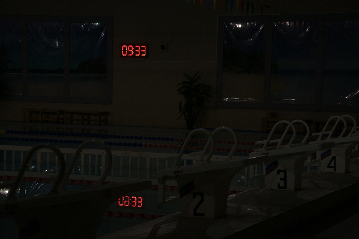
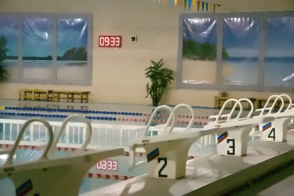

# 🌟 IllumiRefine AI

<div align="center">

**A Hybrid Architecture Combining Self-Calibrated Illumination and Adaptive Frequency Fusion for Extreme Low-Light Image Enhancement**

[](https://pytorch.org/)
[](https://fastapi.tiangolo.com/)
[](https://react.dev/)
[](https://tailwindcss.com/)
[](LICENSE)

*Developed as an M.Sc. Data Science Research Project at **Dhirubhai Ambani University (DA-IICT)**.*

[Key Features](#-key-features) • [Algorithmic Pipeline](#-algorithmic-pipeline) • [Visual Results](#-visual-results) • [Quickstart](#-quickstart-guide) • [API Reference](#-api-reference) • [Contributors](#-contributors--acknowledgments)

</div>

---

## 🚀 Overview

**IllumiRefine AI** is an end-to-end computer vision framework engineered to restore structural fidelity, preserve natural color constancy, and suppress extreme sensor noise in photographs captured under severe photon deprivation and high dynamic range (HDR) constraints.

Traditional histogram equalization and Retinex techniques frequently amplify chromatic grain and produce unnatural washed-out mid-tones. IllumiRefine AI resolves these bottlenecks by combining:
1. **Frequency-domain Homomorphic filtering** for dynamic range compression.
2. **Self-Calibrated Illumination (CVPR 2022)** deep learning for unsupervised, ground-truth-free illumination estimation.
3. **Novel Illumination-Guided Adaptive Denoising & Tone Recovery (Our Contribution)**, utilizing the neural illumination tensor as an alpha-blend mask to selectively denoise pitch-black regions while maintaining crisp foreground edges.

The resulting model runs at **under 1 MB footprint (0.0619 GFLOPs)** with inference speeds of **< 2.0 seconds on standard CPU hardware**.

---

## ✨ Key Features

- 🌓 **Extreme Low-Light Recovery:** Safely recovers deep shadow structures without blowing out HDR highlights (e.g., LED displays, headlights).
- ⚡ **Ultra-Lightweight Neural Footprint:** 3-layer convolutional inference core with an operational footprint of just **0.0619 GFLOPs**.
- 🎯 **Illumination-Guided Adaptive Denoising:** Fast Non-Local Means (NLM) blended via predicted illumination confidence to eliminate chrominance noise spikes.
- 🎚️ **Interactive Studio UI:** Modern, light-themed web interface featuring an interactive **Before/After Split Slider**, **Side-by-Side comparison**, and one-click benchmark samples.
- 🔒 **100% In-Memory Processing:** Direct OpenCV tensor decoding and memory buffer transfers with zero temporary file writes to disk.
- 🛠️ **Production-Ready Microservice:** Fully decoupled architecture with FastAPI REST backend and React client.

---

## 🧠 Algorithmic Pipeline

```
  Input Image (Low-Light)
           │
           ▼
┌──────────────────────────────────────────────┐
│  Phase 1: Frequency-Domain Homomorphic Pre  │
│  • Logarithmic transform: ln(S) = ln(L)+ln(R)│
│  • 2D FFT + Gaussian High-Pass Filter        │
└──────────────────────┬───────────────────────┘
                       │
                       ▼
┌──────────────────────────────────────────────┐
│  Phase 2: Self-Calibrated Illumination (SCI) │
│  • Cascaded unsupervised CNN (CVPR 2022)     │
│  • 3-layer inference core → Illumination Map │
└──────────────────────┬───────────────────────┘
                       │
                       ▼
┌──────────────────────────────────────────────┐
│  Phase 3: SCI-Guided Adaptive Fusion (Novel) │
│  • Exposure gain (1.8×) + Fractional Gamma   │
│  • Fast Non-Local Means (NLM) Candidate      │
│  • Illumination-Weighted Alpha Blend:        │
│    I_final = (1 - L) × I_denoised + L × I_raw│
└──────────────────────┬───────────────────────┘
                       │
                       ▼
            Enhanced Output Image
```

### Phase 1 — Homomorphic Filtering
Models Retinex theory in the Fourier frequency domain. By taking the natural logarithm:

$$\ln(S(x, y)) = \ln(L(x, y)) + \ln(R(x, y))$$

Multiplication transforms into addition. A 2D Fast Fourier Transform (FFT) followed by a Gaussian High-Pass filter dampens low-frequency illumination gradients while sharpening high-frequency reflectance edges.

### Phase 2 — Self-Calibrated Illumination (SCI)
Adopted from the unsupervised SCI framework (CVPR 2022). 
- **Training:** Uses a cascaded learning loop with an auxiliary self-calibration module to converge without requiring paired synthetic ground-truth images.
- **Inference:** Drops the calibration module completely, retaining only a lightweight 3-layer sequential block:
  $$\text{Input}(3) \rightarrow \text{Conv3x3} + \text{ReLU} \rightarrow [\text{Conv3x3} + \text{BN} + \text{ReLU}] \rightarrow \text{Conv3x3} + \text{Sigmoid}$$
- Delivers an operational footprint of **0.0619 GFLOPs**.

### Phase 3 — SCI-Guided Adaptive Fusion *(Novel Contribution)*
Standard Retinex networks produce heavy chromatic noise amplification in pitch-black shadow regions. We introduce a mathematical hybrid post-processing layer:
1. **Dynamic Exposure & Fractional Gamma:** The Retinex division tensor is scaled by an exposure gain ($1.8\times$) and fractional gamma power-law ($\gamma = 0.75$), lifting dark shadows without highlight clipping:
   $$T_{\text{boost}} = \text{clamp}\left( (1.8 \cdot T_{\text{retinex}})^{0.75}, 0, 1 \right)$$
2. **Illumination-Guided Alpha Blend Denoising:** Fast Non-Local Means (NLM) is computed on the boosted tensor. The neural network's illumination map ($L$) acts as an adaptive blending weight:
   $$I_{\text{hybrid}} = (1 - L) \odot I_{\text{denoised}} + L \odot I_{\text{sharp}}$$
   Pixels originally pitch-black ($L \approx 0$) draw heavily from the denoised matrix, while naturally bright regions ($L \approx 1$) preserve raw edge sharpness.

---

## 📸 Visual Results

| Input (Extreme Low-Light Benchmark) | Output (IllumiRefine AI Enhanced) |
| :---: | :---: |
|  |  |
| *Original HDR scene: Severe photon starvation conceals pool architecture.* | *Enhanced: Deep shadows lifted; sensor noise suppressed; red LED clock remains crisp without blowout.* |

---

## 🏗 System Architecture

| Tier | Technology Stack | Functionality |
|---|---|---|
| **Frontend** | React 18, Tailwind CSS, Lucide Icons | Responsive light UI, Before/After Split Slider, Side-by-Side viewer, local state management |
| **API Layer** | FastAPI, Uvicorn | Asynchronous HTTP endpoints, multipart byte streaming, CORS middleware |
| **Inference Core** | PyTorch, OpenCV, NumPy | Direct memory array decoding, `torch.no_grad()` inference, NLM spatial filtering |
| **Model Weights** | TorchScript Checkpoint (`difficult.pt`) | 43 KB serialized convolutional weights |

---

## 💻 Quickstart Guide

### Prerequisites
- **Python**: 3.10, 3.11, or 3.12+ (tested through 3.14)
- **Node.js**: 18+ and `npm`

---

### Step 1: Clone the Repository

```bash
git clone https://github.com/AmanChauhan7010/IllumiRefine-AI.git
cd IllumiRefine-AI
```

---

### Step 2: Set Up and Start the Backend (FastAPI + PyTorch)

1. Create and activate a Python virtual environment:
   ```bash
   # macOS / Linux
   python3 -m venv venv
   source venv/bin/activate

   # Windows
   python -m venv venv
   venv\Scripts\activate
   ```

2. Install backend dependencies:
   ```bash
   pip install -r requirements.txt
   ```

3. Launch the FastAPI server:
   ```bash
   python main.py
   ```
   *The backend will be live at `http://localhost:8000` with interactive Swagger API docs at `http://localhost:8000/docs`.*

---

### Step 3: Set Up and Start the Frontend (React)

Open a **new terminal tab/window**:

```bash
cd frontend

# Install dependencies
npm install

# Start the React development server
npm start
```

*The web UI will automatically open in your browser at `http://localhost:3000`.*

---

## 🔌 API Reference

### 1. Health Check
- **Endpoint:** `GET /`
- **Response:**
  ```json
  {
    "status": "online",
    "message": "IllumiRefine SCI API is running!",
    "docs_url": "/docs",
    "enhance_url": "/enhance"
  }
  ```

### 2. Enhance Image
- **Endpoint:** `POST /enhance`
- **Content-Type:** `multipart/form-data`
- **Parameters:**
  - `file`: Image file (PNG, JPG, JPEG, WEBP)
- **Response:** `image/png` binary stream
- **cURL Example:**
  ```bash
  curl -X POST -F "file=@docs/input_pool.png" http://localhost:8000/enhance -o output.png
  ```

---

## 📂 Repository Structure

```
IllumiRefine-AI/
├── main.py                   # FastAPI REST application & endpoints
├── processor.py              # SCI Neural Network & Adaptive Denoising pipeline
├── p1.py                     # Frequency-domain Homomorphic filter implementation
├── requirements.txt          # Python dependency specifications
├── Dockerfile                # Container deployment definition
├── weights/                  # Pre-trained PyTorch weight checkpoints
│   ├── difficult.pt          # Primary production weights (CVPR '22 SCI)
│   ├── medium.pt
│   └── easy.pt
├── docs/                     # Research figures & benchmark assets
│   ├── input_pool.png
│   ├── output_pool.png
│   └── low_img/              # Evaluation sample images
└── frontend/                 # React web application
    ├── public/
    │   ├── index.html        # HTML shell & font definitions
    │   └── samples/          # Quick-load benchmark demo images
    ├── src/
    │   ├── App.js            # Main Studio UI with Split Slider & View Modes
    │   └── index.js
    └── package.json
```

---

## 🔮 Future Roadmap

- [ ] **Temporal Consistency for Video Streams:** Integrate Recurrent LSTM blocks and optical flow loss to eliminate frame flickering in security feeds.
- [ ] **Mobile & Edge Quantization:** Quantize FP32 weights to INT8 and convert to ONNX / CoreML / TFLite for on-device drone and smartphone deployment.
- [ ] **Downstream Vision Pipeline:** Connect enhanced tensors directly to YOLOv8 / RT-DETR for dark-scene surveillance and autonomous navigation.

---

## 🤝 Contributors & Acknowledgments

### Research & Development Team
- **Chauhan Aman Satpal** — *M.Sc. Data Science, Dhirubhai Ambani University (DA-IICT)* • [LinkedIn](https://www.linkedin.com/in/aman-chauhan2001/) • [GitHub](https://github.com/AmanChauhan7010)
- **Kunal Pramanik** — *M.Sc. Data Science, Dhirubhai Ambani University (DA-IICT)*

### Academic Guidance
- **Dr. Srimanta Mandal** — *Associate Professor, Dhirubhai Ambani University (DA-IICT)*

Special appreciation is extended to the authors of *Self-Calibrated Illumination for Enhancing Low-Light Images* (CVPR 2022) for their open-source contributions to computer vision research.

---

<div align="center">
  <sub>Released under the MIT License • © 2026 Chauhan Aman Satpal</sub>
</div>
